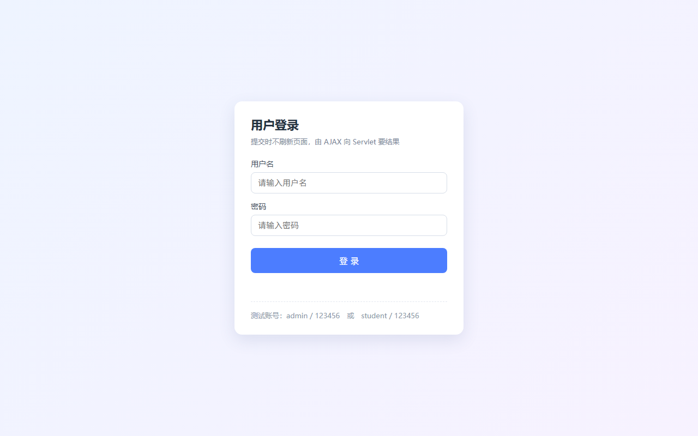
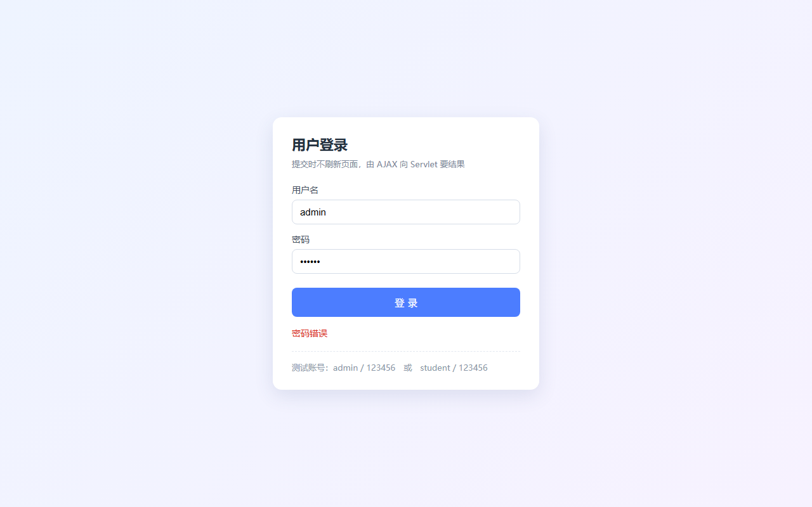
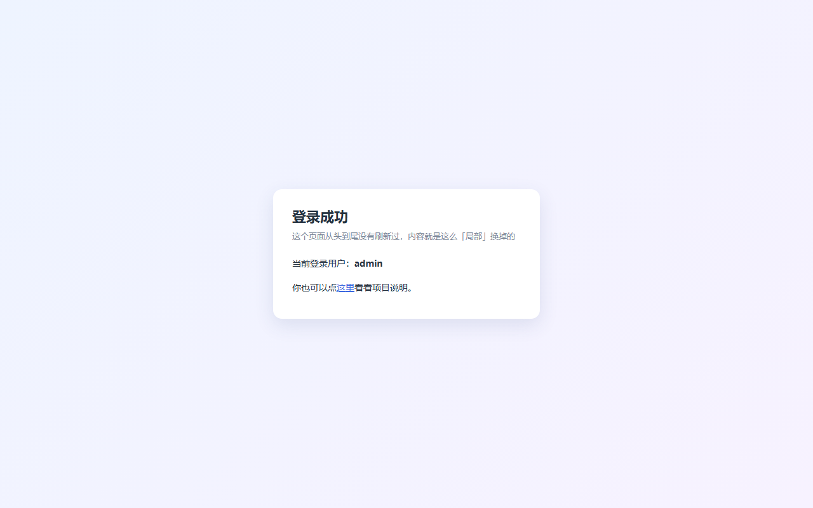

# AJAX 用户登录 Demo（JavaWeb + Servlet）

一个写给初学者的最小可用示例：**登录表单用原生 AJAX 提交，Servlet 返回 JSON，页面不刷新就能显示登录结果。**

不依赖数据库、不依赖任何前端框架，纯 Servlet + HTML + 原生 JS。



## 功能清单

- 登录表单用 `XMLHttpRequest` 异步提交，**页面不刷新**
- Servlet 返回 JSON：`{"success":true,"message":"登录成功，欢迎 admin！"}`
- 三种失败场景分别给出提示：用户名/密码为空、用户名不存在、密码错误
- 登录成功后隐藏登录框，显示欢迎面板（同一个页面里「局部换内容」）
- 中文全程 UTF-8 无乱码（`web.xml` + Servlet 双重设置编码）

## 运行效果

| 用户名不存在 / 密码错误 | 登录成功 |
|---|---|
|  |  |

## 项目结构

```
ajax-login/
├── pom.xml                                  Maven 配置（war 包）
└── src/main/
    ├── java/com/pzy/
    │   ├── model/User.java                  用户实体（用户名 + 密码）
    │   ├── store/UserStore.java             用户仓库，用 Map 代替数据库
    │   └── web/LoginServlet.java            登录 Servlet，返回 JSON
    └── webapp/
        ├── login.html                       ★ 登录页面（AJAX 代码在这里）
        ├── index.html                       项目说明页
        ├── css/style.css                    页面样式（本地文件，不引 CDN）
        └── WEB-INF/web.xml                  欢迎页 + 中文编码配置
```

## 核心思路（3 步）

1. **页面**不再用 `<form action="login" method="post">` 直接提交，而是给按钮绑 JS：
   取输入框的值 → `XMLHttpRequest` 发到 `login` → 在 `onreadystatechange` 里处理返回结果。
2. **Servlet** 不再 `sendRedirect` / `forward` 页面，而是 `setContentType("application/json;charset=UTF-8")`，
   直接把一小段 JSON 写回响应体。
3. **页面**拿到 JSON 后自己决定怎么变：改提示文字颜色、显示欢迎面板 —— 全程没有刷新。

## AJAX 关键代码（login.html）

```javascript
var xhr = new XMLHttpRequest();
xhr.open('POST', 'login', true);                              // 请求地址就是 Servlet 的 @WebServlet("/login")
xhr.setRequestHeader('Content-Type', 'application/x-www-form-urlencoded');
xhr.onreadystatechange = function () {
    if (xhr.readyState === 4 && xhr.status === 200) {
        var data = JSON.parse(xhr.responseText);              // {"success":true,"message":"..."}
        showTip(data.message, data.success);
    }
};
xhr.send('username=' + encodeURIComponent(username)
       + '&password=' + encodeURIComponent(password));
```

## 后端关键代码（LoginServlet.java）

```java
@WebServlet("/login")
public class LoginServlet extends HttpServlet {
    protected void doPost(HttpServletRequest request, HttpServletResponse response) throws IOException {
        request.setCharacterEncoding("UTF-8");
        response.setContentType("application/json;charset=UTF-8");

        String username = request.getParameter("username");
        String password = request.getParameter("password");
        // ……校验后写回 JSON
        response.getWriter().write("{\"success\":true,\"message\":\"登录成功\"}");
    }
}
```

## 怎么跑起来

**方式一：IntelliJ IDEA（推荐）**

1. IDEA 打开本项目根目录，等 Maven 自动导入依赖；
2. `Run → Edit Configurations → + → Tomcat Server → Local`，选本机 Tomcat 9；
3. `Deployment` 标签页点 `+ → Artifact`，选 `ajax-login:war exploded`，Application context 填 `/ajax-login`；
4. 启动后浏览器访问 <http://localhost:8080/ajax-login/login.html>。

**方式二：命令行打 war 包丢进 Tomcat**

```bash
mvn clean package
# 把 target/ajax-login.war 复制到 Tomcat 的 webapps/ 目录，然后启动 Tomcat
# 访问 http://localhost:8080/ajax-login/
```

> 环境要求：JDK 17+、Tomcat 9（`javax.servlet`）。如果用的是 Tomcat 10/11，需要把 pom 里的
> `javax.servlet-api` 换成 `jakarta.servlet-api`，Java 代码里的 `javax.servlet.*` 也换成 `jakarta.servlet.*`。

## 测试账号

| 用户名 | 密码 |
|---|---|
| admin | 123456 |
| student | 123456 |

## 说明与可扩展方向

- 账号存在内存 `Map` 里（`UserStore`），重启 Tomcat 就回到初始状态。想换成 MySQL：只改
  `UserStore.findByUsername()` 的方法体（写 JDBC 查询），Servlet 和页面都不用动。
- 现在只返回「成功/失败」，真实项目里登录成功后一般还要
  `request.getSession().setAttribute("user", user)` 记住登录状态，再由其他 Servlet 校验。
- 密码示例中是明文直接比较，真实项目必须存加密后的哈希（如 BCrypt），**不要在生产中明文存密码**。
- AJAX 用的是原生 `XMLHttpRequest`（课上最常见的老写法）。等理解了原理，可以对比看同样功能的
  `fetch` 写法，代码会更短：

```javascript
const res = await fetch('login', {
    method: 'POST',
    headers: { 'Content-Type': 'application/x-www-form-urlencoded' },
    body: new URLSearchParams({ username, password })
});
const data = await res.json();
```
